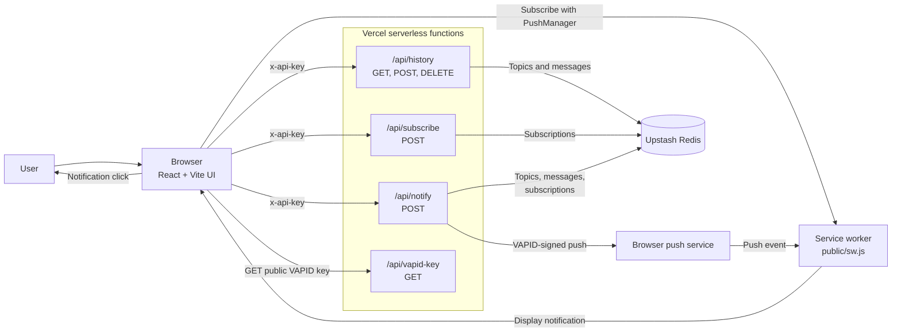

# PingBox

A private, topic-based push notification inbox for sending messages to subscribed browsers and managing them in one place.

[](https://react.dev/)
[](https://vite.dev/)
[](https://vercel.com/)
[](https://upstash.com/redis)
[](https://developer.mozilla.org/en-US/docs/Web/API/Push_API)

## Architecture



Topics organize inbox history; notifications are delivered to all active subscriptions. Message history is stored separately for each topic, with up to 50 messages retained per topic.

## Features

- Send push notifications with an optional title, message, and link.
- Organize message history into topics, including the default `general` topic.
- Create and delete topics, and clear or delete individual messages.
- Subscribe the current browser to push notifications.
- Store topics, messages, and browser subscriptions in Upstash Redis.

## Requirements

- Node.js and npm
- An Upstash Redis database
- VAPID public and private keys for Web Push
- A Vercel project (or compatible host for the `api/` serverless functions)

## Configuration

Set these environment variables in the deployment environment:

| Variable | Required | Description |
| --- | --- | --- |
| `API_SECRET` | Yes | Shared secret used to authorize history, subscription, and notification API requests. Enter this value in the app's settings. |
| `UPSTASH_REDIS_REST_URL` | Yes | Upstash Redis REST URL. |
| `UPSTASH_REDIS_REST_TOKEN` | Yes | Upstash Redis REST token. |
| `VAPID_PUBLIC_KEY` | Yes | Public VAPID key, returned to the browser when it requests push permission. |
| `VAPID_PRIVATE_KEY` | Yes | Private VAPID key used by the server to send push notifications. Keep this secret. |
| `VAPID_SUBJECT` | No | Contact URI for the VAPID identity, such as `mailto:admin@example.com`. Defaults to `mailto:admin@example.com`. |

Use the same VAPID key pair for the server and browser subscription flow. Never expose `API_SECRET`, `UPSTASH_REDIS_REST_TOKEN`, or `VAPID_PRIVATE_KEY` in frontend code.

## Local development

Install dependencies and start the Vite frontend:

```sh
npm install
npm run dev
```

The Vite development server serves the frontend. The `/api` endpoints are serverless functions and require a compatible runtime; use `vercel dev` for local full-stack development after configuring the environment variables.

Available project scripts:

```sh
npm run lint
npm run build
npm run preview
```

## API overview

| Endpoint | Methods | Purpose |
| --- | --- | --- |
| `/api/vapid-key` | `GET` | Returns the public VAPID key for browser subscription. |
| `/api/subscribe` | `POST` | Saves a browser push subscription. Requires `x-api-key`. |
| `/api/notify` | `POST` | Stores a notification in its topic and sends it to subscribed browsers. Requires `x-api-key`. |
| `/api/history` | `GET` | Returns available topics and messages for the selected topic. Requires `x-api-key`. |
| `/api/history` | `POST` | Creates a topic. Requires `x-api-key`. |
| `/api/history` | `DELETE` | Deletes a message, clears a topic's messages, or deletes a topic. Requires `x-api-key`. |

## Data in Redis

- `pingbox:topics` - set of topic names.
- `pingbox:msg:<topic>` - newest-first message history for a topic.
- `pingbox:subs` - browser push subscriptions keyed by endpoint.
